# Лабораторная №1 Введение в виртуальные машины и установка Debian.
Выполнил: Шуров А.А.
Группа: ИС-25
## Установка и базовая настройка ВМ.
### Установка VirtualBox и настройка изначальных парамтеров ВМ.
 Установлен гипервизор Oracle VirtualBox с официального вебсайта https://www.virtualbox.org/wiki/Downloads.
 Установлено имя ВМ.
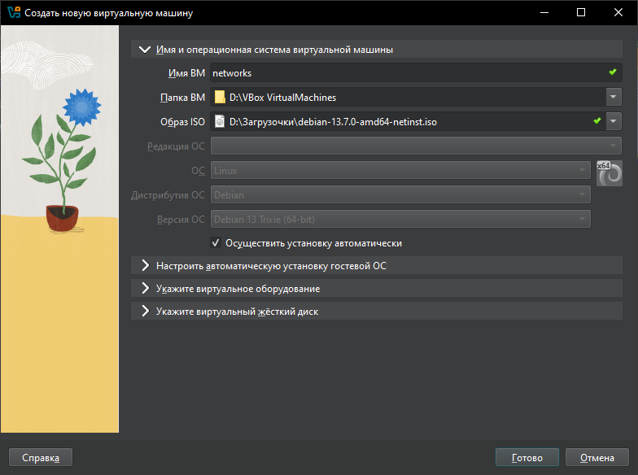 
 Установлено имя пользователя ВМ.
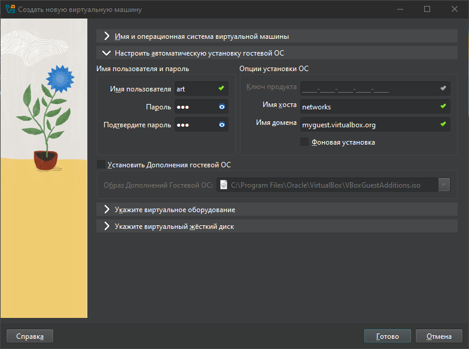 
 Выделена оперативная память и количество ЦПУ для ВМ.
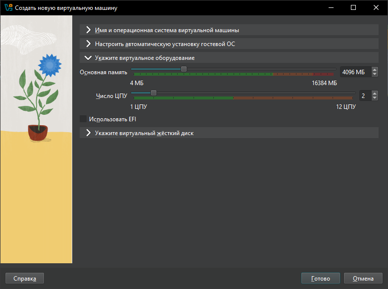  
 Выделена память на жёстком диске для ВМ.
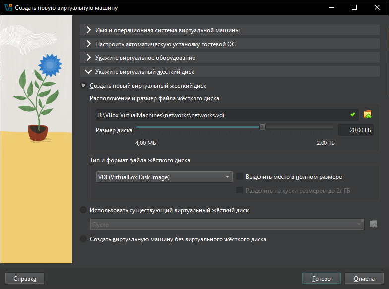  
 ВМ настроена, запускается без ошибок.
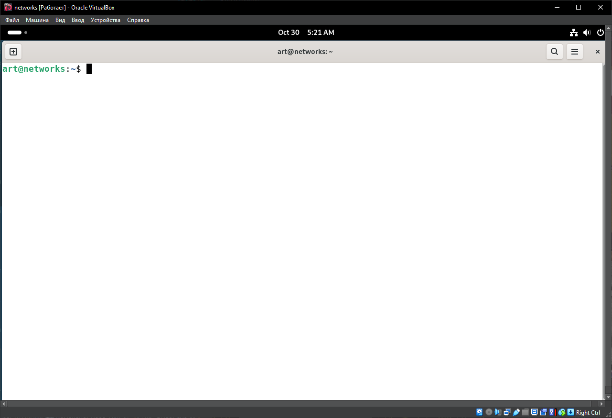  
### Настройка параметров внутри ВМ.
 Добавлен новый пользователь - testuser.
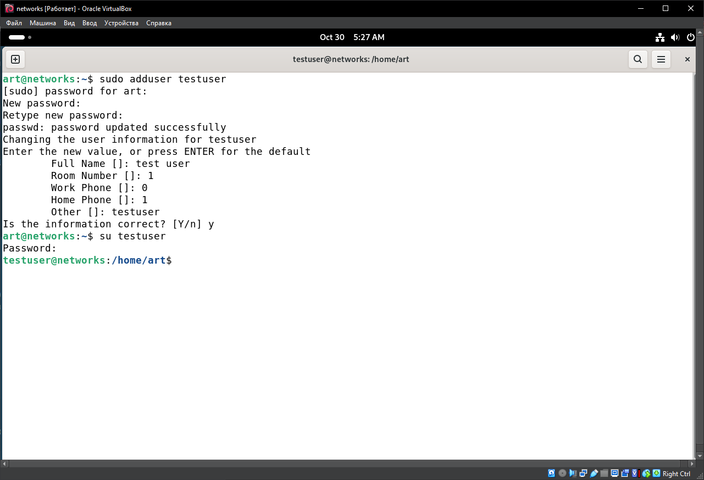 
 Вызвано окно конфигурации локалей используя команду dpkg-reconfigure locales.  В списке доступных локалей выбранна русская, после перезагрузки установлен желаемый язык.
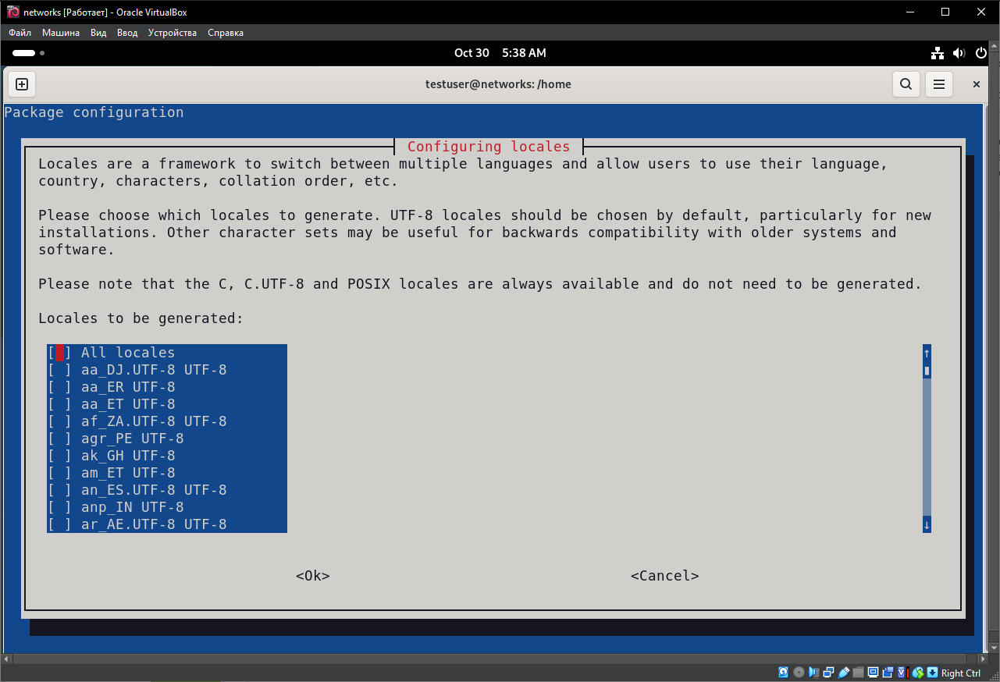 
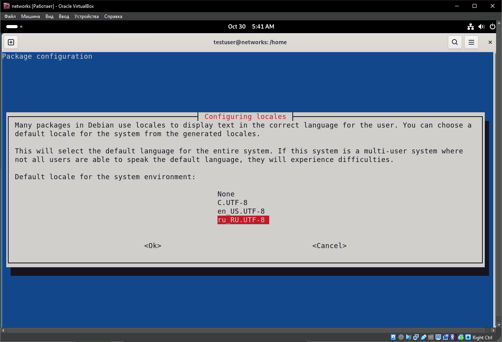 
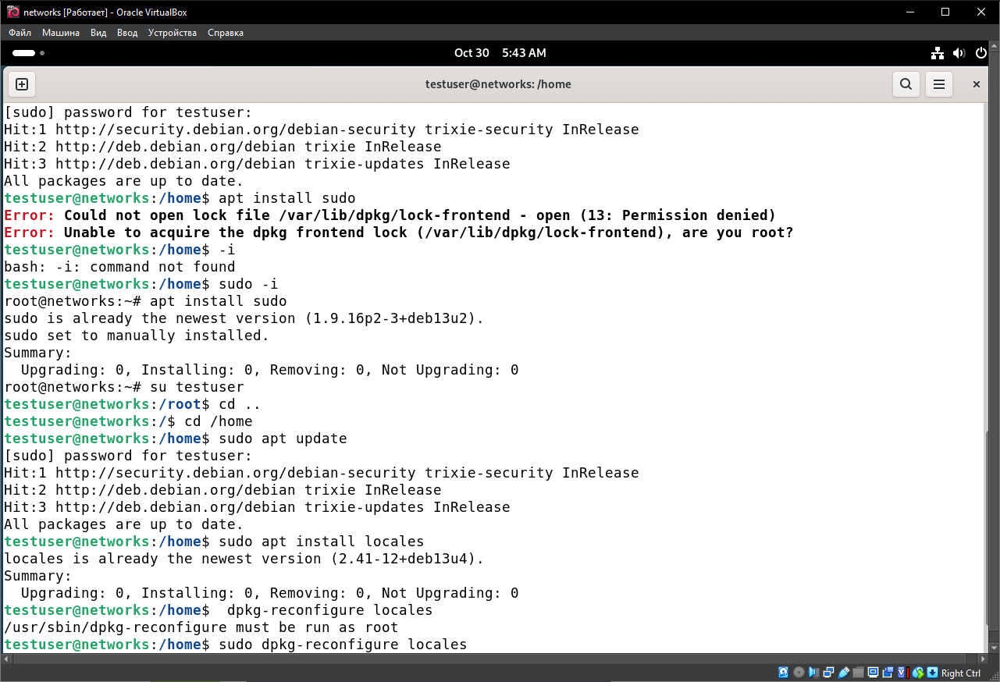 
 Тестовому пользователю выданы привелегии суперюзера.
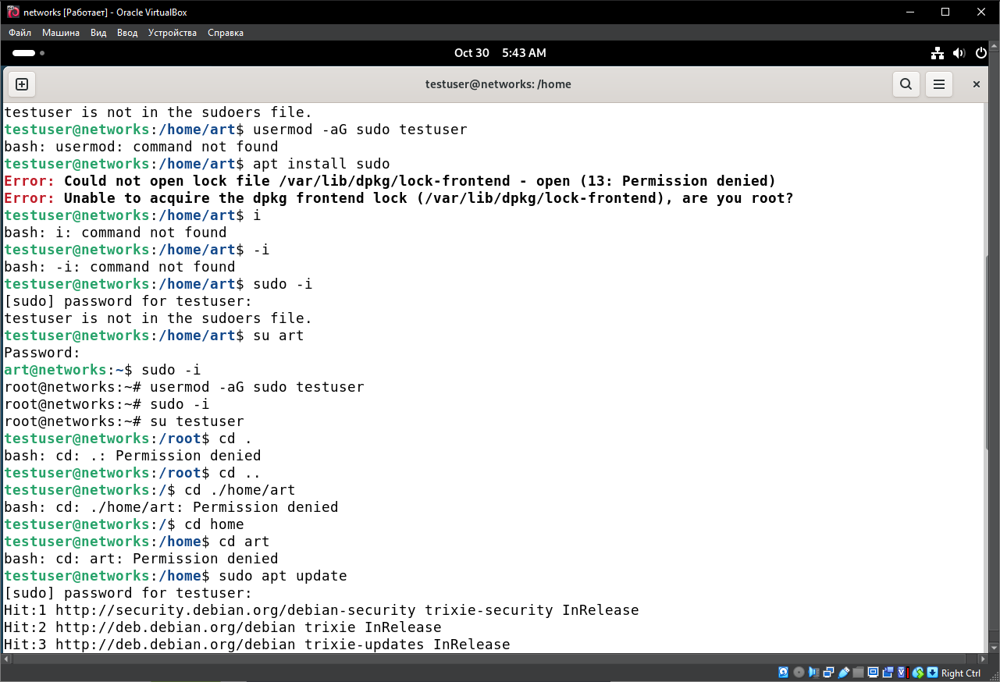 
 С помощью команды dpkg-reconfigure tzdata открыто окно конфигурации настроек временной зоны и выбрана желаемая зона.
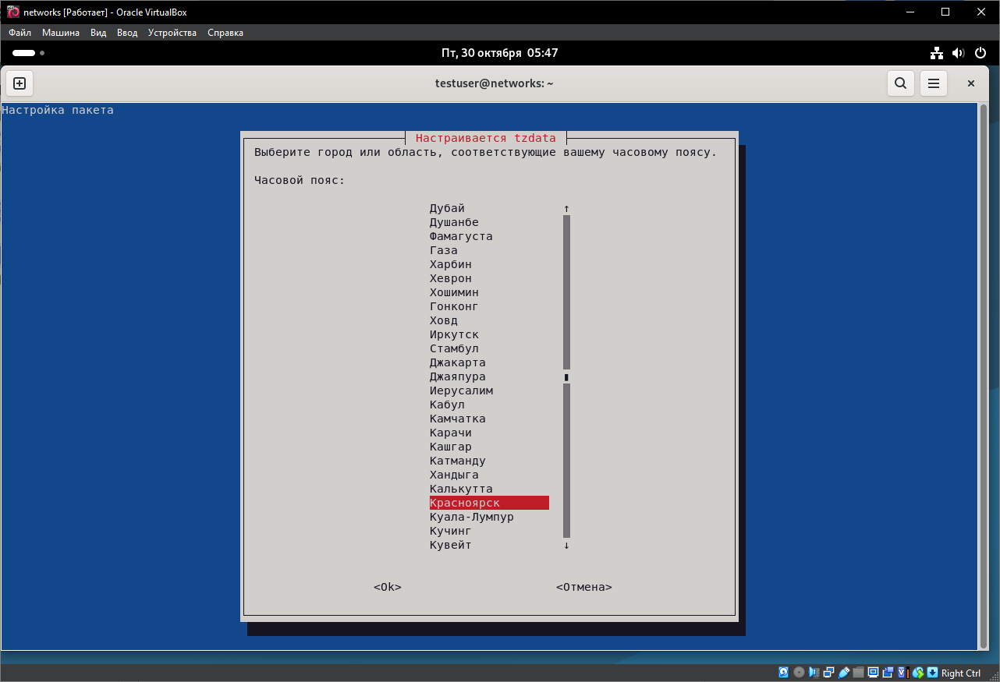
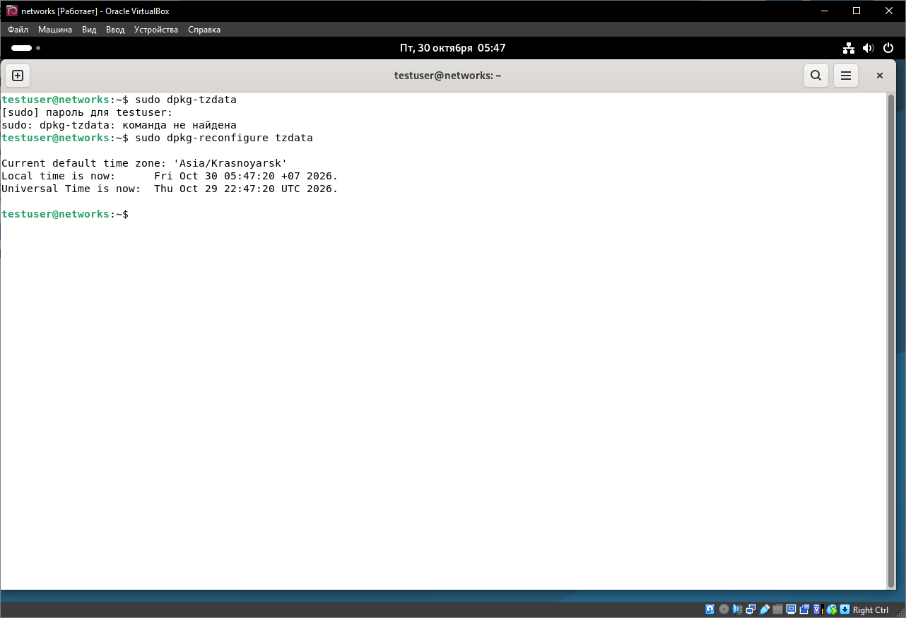 
## Настройка сетевого подключения и загрузка обновлений.
 Проверены подключения через сетевые адаптеры: перечислены подключения NAT (enp0s3) и Briged (enp0s8). В дальнейшем используется Briged подключение.
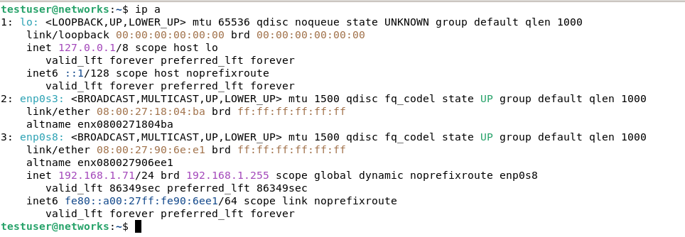 
 Соединение проверенно пингом Гугла 12 пакетами, ни один из которых не теряется, что подтверждает успешно установленное соединение.  
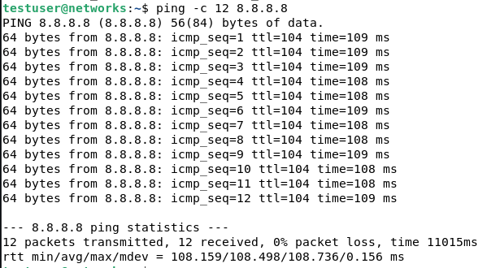 
 Проведён поиск обновлений, версия системы актуальна и не требует дополнительных подгрузок.
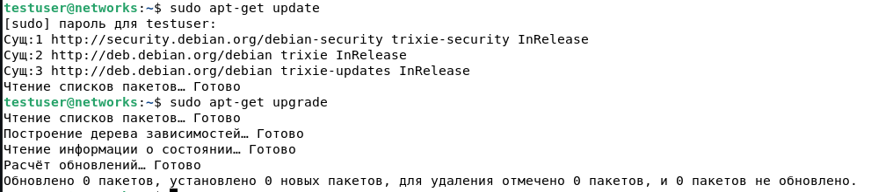 
## Установка SSH сервера, его настройка, и удалённое подключение к гостю из хоста.
### Подключение с использованием пароля.
 Успешно установлен OpenSSH.
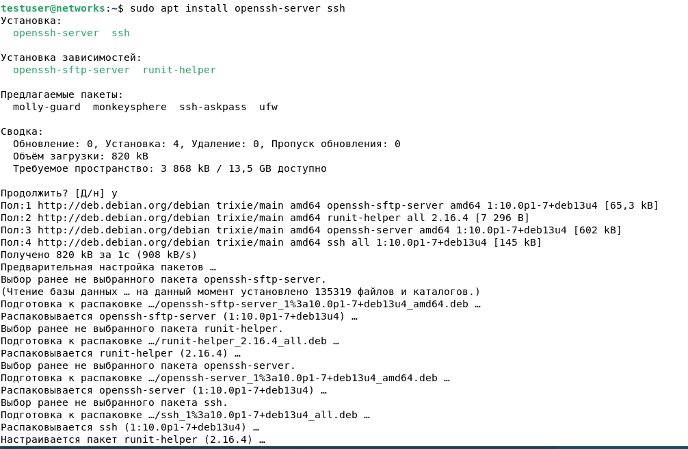 
 SSH сервер активен.  
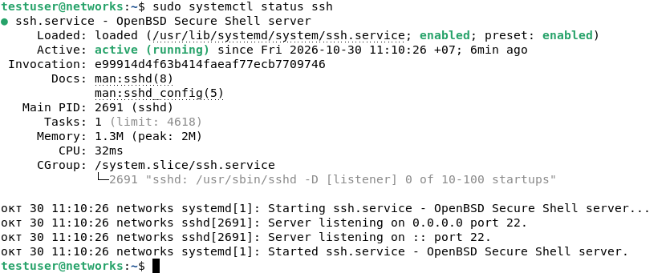 
 Из машины хоста через командную строку установлено подключение к ВМ через SSH сервер, с вводом пароля.
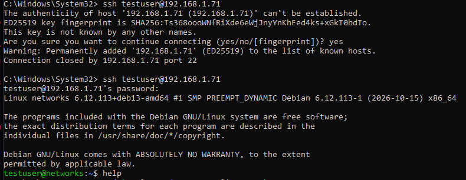 
### Подключение с использованием ключей доступа.
 Сгенерирована пара ключей используя алгоритм Ed25519.  
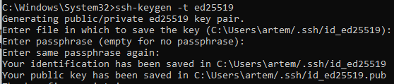 
 Содержание файла публичного ключа передано в ВМ, в которой создаётся директория .ssh и файл для авторизованных ключей authorized_keys, которым выдаются уровни доступа chmod 600 (Владелец может читать и менять, но не выполнять) и chmod 700 (Владелец может читать, менять и выполнять). В authorized_keys записывается содержание ключа. Происходит успешный вход в систему без ввода пароля.
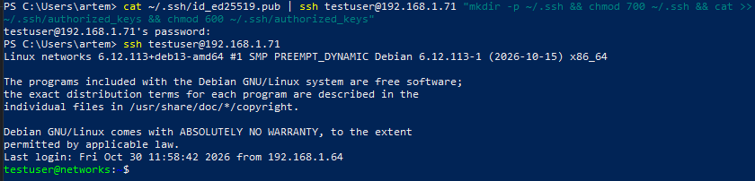 
# Вывод:
В процессе выполнения лабораторной работы установлен гипервизор Oracle VirtualBox, создана и настроена виртуальная машина. Настроен сервер SSH, и подключение к гостю через ключи аутентификации SSH.
